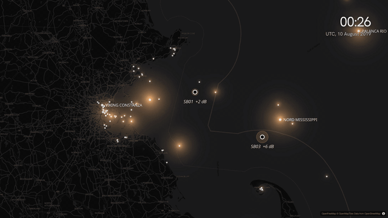
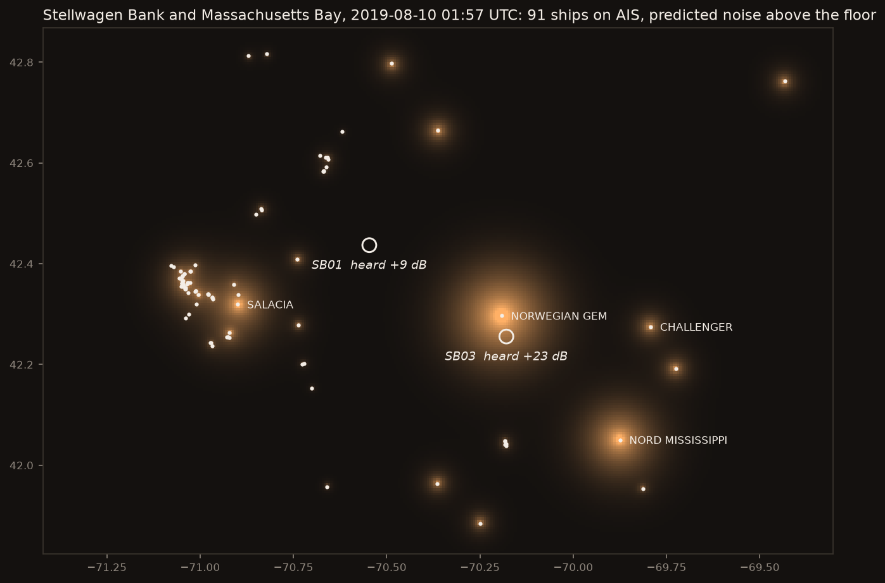

# Hydrolocator

[](https://github.com/MrBongoC/hydrolocator/actions/workflows/ci.yml)

Match the ship noise in a hydrophone recording to the ships that made it, using public
AIS tracks.



It answers three questions.

- **Which ships passed?** A recording, its position and its start time give a table of
  the vessels that explain what was heard (name, MMSI, type, closest approach, range,
  speed), plus the sounds that no ship on AIS explains. The code calls this Mode A.
- **Where was this recorded?** A recording and its start time give a ranking of public
  hydrophone sites, a confidence, and the recorder's clock error if the time was rough.
  The code calls this Mode B.
- **What did a whole bay sound like that day?** The sound map above plays every AIS ship
  with its predicted noise, beside what two hydrophones recorded.

This repository is the engine: the AIS store, the level model, the matching, a CLI and a
JSON API. The clip was rendered by a web front end that is not included here. It draws
what `/api/soundmap` returns, and `examples/plot_soundmap.py` draws the same data
with matplotlib so you can check it yourself.

Every number in this README was measured on real public recordings and real AIS. Only the
unit tests use simulated tracks. It is a research prototype, and several of its own
targets are not met. The results section says which.

## Try it

Needs [uv](https://docs.astral.sh/uv/) (it installs Python 3.13) and `ffmpeg` for
anything that reads audio.

```sh
git clone https://github.com/MrBongoC/hydrolocator
cd hydrolocator
uv sync
uv run python examples/plot_soundmap.py --time 01:57 --out frame.png
```

One built day ships with the repo (10 August 2019, Massachusetts Bay, 1.5 MB), so that
command downloads nothing. It draws the moment a 294 m cruise ship passes 4.5 km from
hydrophone SB03:



Everything else needs AIS for the day you ask about, which is one download per day:

```sh
uv run hydrolocator ais ingest 2020-02-24          # 300 to 400 MB download, about 10 MB kept
uv run hydrolocator catalog --date 2020-02-24      # hydrophones recording that day

# Which ships passed
uv run hydrolocator who --site sanctsound:sb01 --start 2020-02-24

# Where was this recorded: read a public recording and hide which site it is
uv run hydrolocator where --site sanctsound:sb01 --start 2020-02-24 --refine

# The same on your own file, start time uncertain by an hour
uv run hydrolocator where --audio clip.flac --start 2020-02-24T05:00 --clock-hours 1
```

Add `--json` to `who`, `where` or `blindtest` for machine-readable output.

The same things are available over HTTP:

```sh
uv run hydrolocator serve          # http://127.0.0.1:8000/api/docs
curl 'http://127.0.0.1:8000/api/soundmap?region=stellwagen&date=2019-08-10'
```

`POST /api/analyze` starts a job, `/api/jobs/<id>` reports progress and
`/api/results/<id>` is the saved result.

Downloads and caches go to `data/` in the repo folder. Set `HYDROLOCATOR_DATA` to keep
them elsewhere.

```sh
uv run pytest
uv run ruff check src tests examples
```

## How well it works

The targets were set before any data was looked at. The measurements came after.

| Question | Target | Measured | Verdict |
| --- | --- | --- | --- |
| Are the AIS ships that pass heard? | 80% of AIS vessels within 2 km detected | 57% of 251 vessels making way within 2 km. 78% of the 23 that were 50 m or longer. Chance is about 33%. | Not met |
| Speed and range from sound alone | median speed error under 2 kn | Doppler is not built. Fringe fitting gives range and speed within 10 to 20% on clear passages and wrong answers on others. | Not met |
| Naming the site of a 24 h clip | 90% right on 100 held-out clips | 53% right on 43 held-out site-days (23 of 43). Stellwagen alone was 16 of 19. With the confidence gate (z of 4 or more) it was 12 of 12, covering 28% of clips. | Not met as stated |
| Placing a recorder on a 500 m grid | median error under 5 km | On six Stellwagen days the best cell was 0.7 to 6 km from the true mooring (median 2.9 km). Two of the six ran into the edge of the 6 km search box. Only tried around a known site. | Unproven |

The site test missed its target, and the data supports a narrower claim: **site naming is
reliable when it says it is.** It named the right site every time it reported high
confidence, and it reported high confidence on about a quarter of 24 h clips, nearly all
from water with large-ship traffic within a few kilometres. Quiet sites (Gray's Reef was
0 of 7) cannot be located from ship noise at all, and the tool says "no site stands out"
for them instead of guessing.

Shorter clips are much weaker: 38% right at 12 h and 27% at 6 h.

Other measurements:

- A clip stamped five hours wrong (a timezone slip) still ranked the right site first
  (z 3.0 against 1.3 for the runner-up) and the clock error came back as 4 h 59 min. The
  verdict was "no site stands out" all the same. Searching 1,681 clock offsets costs
  about three points of z, which puts a one-day clip below the confidence gate.
- MBARI's MARS hydrophone (891 m deep, never used in fitting) ranked first of 20 on its
  test day at z 3.7, which the tool reports as "probably".
- Site naming over 20 candidate sites, plus the vessel table and a 1,089-cell grid, takes
  2.8 s for a 24 h clip once spectra are cached. Streaming and decimating 24 h of archive
  audio takes one to three minutes the first time.
- The AIS index for all seven regions is about 10 MB per day, so a decade fits in roughly
  40 GB.

These figures come from 20 AIS days between 15 March 2019 and 1 August 2021. SanctSound
recorded from late 2018 to early 2022, so test dates sit in that window.

## What the data taught

1. **The level curve beats discrete events.** The first design matched a list of
   passages to AIS closest approaches, within two minutes. On real recordings the level
   peak of a passage is only good to a few minutes: the top of the peak is flat, ships
   are louder astern, and shallow-water propagation is uneven. Each matched event then
   carries about one nat of evidence. Correlating the whole observed level curve against
   the curve AIS predicts for a position did better: 16 of 19 against 12 of 19 on the
   same held-out Stellwagen days. Event matching is kept for the vessel table.
2. **Interference fringes are what shows up.** At 2 to 4 km in shallow water the
   spectrograms show a clean interference "bathtub" and few usable narrowband lines.
   `characterise.py` fits the bathtub for closest-approach time and range over speed. It
   is experimental and takes no part in the score.
3. **SanctSound stood in for Ocean Networks Canada.** ONC needs an API token. NOAA
   SanctSound needs none and covers 31 sites in MarineCadastre AIS waters, with audio,
   one-minute spectra for some sites, and NOAA's own ship-detection logs.
4. **Logged detections are too coarse to locate with.** SanctSound's ship logs give
   audible periods of up to two hours, merged across ships. They reached 42% on the
   site test.
5. **No compiled hot path yet.** numpy is far inside the time budget for catalog search
   and local grids. A compiled service becomes worth it for region-wide grids.

## How it works

1. **Ingest** (`ingest.py`). ffmpeg reads a file or a remote object, mixes to mono and
   writes a 2 kHz 24-bit FLAC. Spectra are 1 Hz bins in 10 s frames. Nothing is
   calibrated. Only level relative to the clip's own floor is used.
2. **AIS store** (`ais.py`). MarineCadastre daily CSV is clipped to seven regions and
   written as one Parquet file per UTC day, queried with DuckDB. Tracks become straight
   legs, and gaps over 15 minutes are never bridged.
3. **Predict** (`soundscape.py`, `cpa.py`). For a position, every vessel within 45 km
   contributes source power (from length and speed) spread over range. The sum over a
   noise floor is the predicted excess level. Closest approaches have a closed form per
   leg.
4. **Score** (`pipeline.py`). Correlate observed and predicted excess. The z-score
   compares that correlation with the same two curves at shifts of 45 minutes or more.
   Confidence is `softmax(2.5 z)` over the candidates plus "none of these" at z 3.6, set
   from held-out results.
5. **Explain** (`score.py`). Detected peaks are assigned to AIS passages one to one.
   Unmatched peaks of 6 dB or more are listed as sounds with no AIS match.

The level model's five parameters were fit on training days (every other day held out)
starting from textbook values and stayed close to them: 19 dB per decade of range,
0.8 dB/km absorption, 14 dB per decade of length, 19 dB per decade of speed.

## Sound map

`GET /api/soundmap` (or `soundmap.build` in Python) returns one day over Massachusetts
Bay as a single JSON document:

| Field | What it holds |
| --- | --- |
| `bbox`, `steps`, `step_s` | The chart bounds (west, south, east, north) and 720 two-minute steps. |
| `vessels` | Name, MMSI, type, length and flag for up to 320 vessels that moved that day. |
| `lat`, `lon` | Base64 int16, vessels by steps: each position scaled across the bounds, with -32768 for "not in view". |
| `src` | Base64 int8, vessels by steps: the model's source level in dB from length and speed. |
| `model` | The propagation constants, so a client can draw the noise field itself. |
| `posts` | Each hydrophone: position, the level curve it heard, the curve AIS predicts, and each heard peak with the ship matched to it. |
| `ranking` | The day's loudest ships by rough source level. |
| `ghosts` | Sounds with no AIS match that were linked across both hydrophones, each with a possible track. |

Two things to keep straight when reading it, or the clip made from it:

- **The glow is a model.** It is predicted from each ship's length and speed. The rings
  are the recordings.
- **The dashed tracks are guesses.** They mark sounds that match no AIS vessel within
  20 km, heard at both hydrophones. One hydrophone gives no direction, so each track is
  borrowed from AIS ships that made the same crossing at a similar speed. They may not
  be ships at all.

The ranking is a rough source level: received level (calibrated archive spectra, 20 to
900 Hz) plus spreading loss, and only for passages where one ship is louder than all the
others together by 6 dB. On 10 August 2019 that puts a 294 m cruise ship doing 21 kn at
about 188 dB and harbour tugs near 175 dB. Repeat passages of the same ship agreed to
about 3 dB in a 20-day check.

Other days build once their AIS is ingested. The spectra are fetched on demand, about
4 MB per site-day.

## Ships

Four more features use open ship data and more than one hydrophone. Each result carries
a note on how far it can be trusted.

| Feature | What it does | Measured |
| --- | --- | --- |
| Vessel records | Flag from the MMSI. IMO number, call sign, beam and draught from AIS. Operator, photograph and article from Wikidata by IMO number. | Wikidata had a record for 4 of the first 8 IMO numbers looked up. |
| Silent-AIS candidates | For a sound with no AIS match, lists vessels that stopped reporting for 15 minutes to 6 hours on a straight course past the hydrophone at about that time. | A median of 0 to 1 such courses per site-day, up to 22 on a busy summer day. No ground truth to score it against. |
| Voiceprints | Compares a sound's machinery lines with a library of AIS-matched passages from the same waters ("sounds like"). | 373 signatures from 252 vessels. The closest match named the right vessel 17% of the time (chance is about 2%), so it is a hint only. |
| Two-site tracks | Links sounds with no AIS at two hydrophones and gives each a speed and a route taken from AIS vessels that made the same crossing. | Stellwagen SB01 and SB03, 36 km apart, 15 AIS ships with their AIS hidden. Given the right pair, speed was within 0.6 kn and range within 0.3 km (medians). The right pair was chosen 9 times of 15. |

Naval, coast guard and law-enforcement vessels appear in tables like any other AIS
vessel, but no acoustic signature is kept for them.

The two-site method has only been tested on one pair of sites.

`hydrolocator live` follows one of Orcasound's live hydrophones and reports ship noise as
it rises and fades. It cannot name the ship. That needs live ship positions, and
MarineCadastre publishes months late.

```sh
uv run hydrolocator tracks sanctsound:sb01 sanctsound:sb03 --start 2019-08-10
uv run hydrolocator voiceprints                 # rebuild the signature library
uv run hydrolocator live                        # list live nodes
uv run hydrolocator live orcasound-lab --minutes 5
uv run hydrolocator blindtest                   # the site test on held-out days
uv run hydrolocator blindtest --hours 6
```

## Layout

```
src/hydrolocator/
  ingest.py         audio to 2 kHz copy and spectra; start time from filenames
  ais.py            MarineCadastre to Parquet; track loading
  cpa.py            closest-approach prediction
  soundscape.py     predicted level curve and correlation
  detect.py         passage detection from a band-level series
  score.py          passage-to-vessel assignment
  characterise.py   interference-fringe fit (experimental)
  shipdata.py       flag from MMSI, Wikidata records by IMO number
  suspects.py       vessels whose AIS was silent on a course past the site
  voiceprint.py     vessel signature library and "sounds like" hints
  multisite.py      two-hydrophone linking and track inference
  soundmap.py       one day of vessels, hydrophone curves and rankings for the map
  live.py           live listening on Orcasound streams
  pipeline.py       who_passed, locate, grid_search
  catalog.py        public hydrophone catalog
  public.py         site + time window to a clip
  blindtest.py      held-out evaluation and fitting
  report.py         JSON for the CLI and API
  api.py, cli.py
  sources/          sanctsound.py, mbari.py, orcasound.py
  data/             the catalog (32 sites) and the sample sound-map day
tests/              unit tests on simulated tracks, plus the sample day
examples/           plot_soundmap.py, one moment of a sound-map day with matplotlib
probes/             standalone scripts that prove each external call
data/               downloads and caches (not in git)
```

## Data

Nothing here is private. All of it is published by the organisations below, and none of
it needs an account.

| Source | Used for | Terms |
| --- | --- | --- |
| [NOAA SanctSound](https://catalog.data.gov/dataset/sanctsound-raw-passive-acoustic-data), bucket `noaa-passive-bioacoustic` | audio, one-minute spectra, ship logs, deployment metadata | The NCEI record lists the raw audio as CC0. Cite NOAA Office of National Marine Sanctuaries and the U.S. Navy. |
| [MBARI Pacific Sound](https://docs.mbari.org/pacific-sound/), bucket `pacific-sound-2khz` | MARS audio | CC BY 4.0 |
| [MarineCadastre AIS](https://marinecadastre.gov/ais) | ship positions | U.S. government data, public domain |
| [Orcasound](https://registry.opendata.aws/orcasound/) | live hydrophone streams | CC BY-NC-SA 4.0 |
| [Wikidata](https://www.wikidata.org) | vessel records by IMO number | CC0 |

The sample day in `src/hydrolocator/data/soundmaps/` is derived from MarineCadastre AIS
and SanctSound spectra for Stellwagen Bank sites SB01 and SB03.

Two quirks worth knowing: MarineCadastre's 2021 files spell a header
`TranscieverClass`, and the SanctSound bucket has one misfiled duplicate deployment
(`hi01/sanctsound_hi03_03_ships`). Both are handled.

## Guardrail

Site naming only scores positions in the public catalog and grids around them, inside
the seven listed regions. There is no free-form search and no military or undisclosed
sites.

## Not built yet

- A reader for Ocean Networks Canada (needs `ONC_TOKEN`; `probes/onc_oceans3.py` is ready).
- A live AIS feed, which live mode needs to name ships.
- Doppler speed and range, and a vessel-class model.
- Region-wide grid search for recordings made away from catalog sites.
- Rate limiting on the API. Run it locally, or put it behind something that limits.

Uploads are deleted as soon as analysis ends.

## Prior art and open questions

- **Has anyone gone from audio plus time to location before?** A search found no tool
  that does it. The nearest work: Verlinden's UCSD dissertation uses AIS-tracked ships as
  known sources for localisation with measured replicas; a 2025 arXiv paper ranges a ship
  from one hydrophone by waveguide-invariant striations (the same fringes used here); a
  BSH ship-noise report uses AIS closest-approach times to estimate recorder clock drift.
  A proper review is still owed.
- **Can a clip be dated as well as placed?** The clock search already does this within
  plus or minus 14 h. Searching across days is the same code with more AIS loaded.

## Licence

The code is MIT licensed (see `LICENSE`). The data keeps the terms of its publishers,
listed above.
